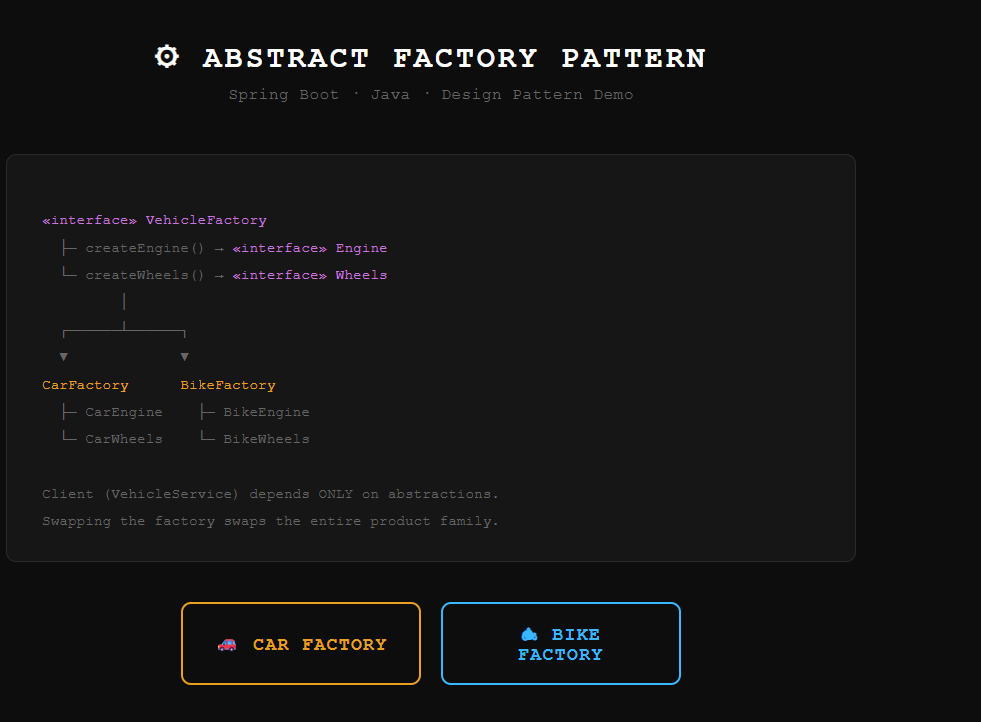
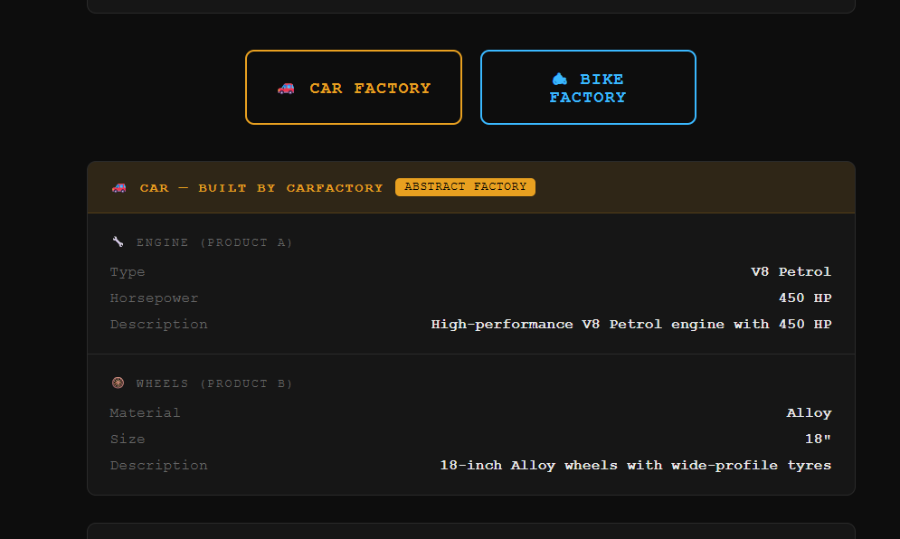
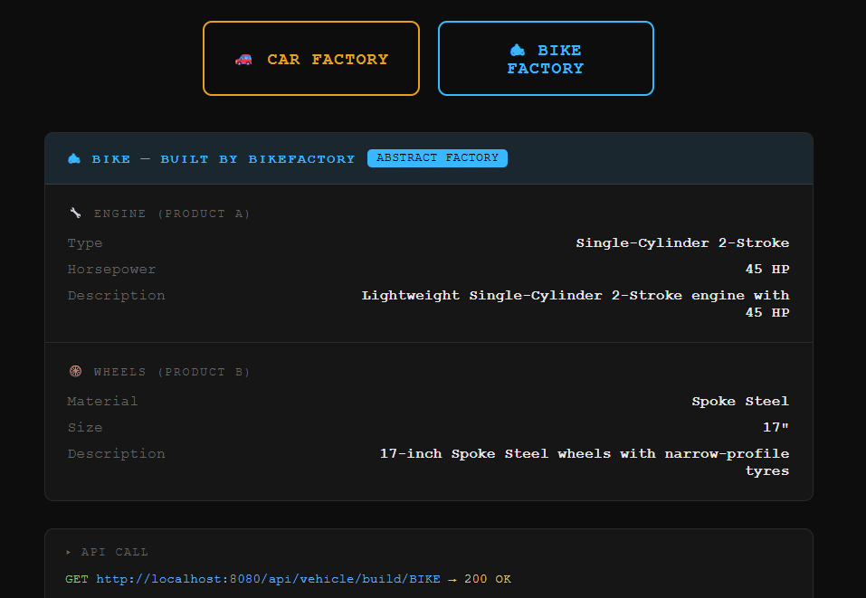

Project Structure
abstract-factory/
├── pom.xml
├── frontend.html                          ← open directly in browser
└── src/main/java/com/demo/factory/
├── AbstractFactoryApp.java
├── products/
│   ├── Engine.java       ← Abstract Product A
│   ├── Wheels.java       ← Abstract Product B
│   ├── CarEngine.java    ← Concrete Product A1
│   ├── BikeEngine.java   ← Concrete Product A2
│   ├── CarWheels.java    ← Concrete Product B1
│   └── BikeWheels.java   ← Concrete Product B2
├── factories/
│   ├── VehicleFactory.java  ← Abstract Factory interface
│   ├── CarFactory.java      ← Concrete Factory 1
│   └── BikeFactory.java     ← Concrete Factory 2
├── service/
│   └── VehicleService.java  ← Client — uses only abstractions
└── controller/
└── VehicleController.java

How the Pattern Works
RoleClassAbstract FactoryVehicleFactory interfaceConcrete Factory 1CarFactory — creates CarEngine + CarWheelsConcrete Factory 2BikeFactory — creates BikeEngine + BikeWheelsAbstract ProductsEngine, Wheels interfacesClientVehicleService — never touches concrete classes
The key insight: VehicleService only calls factory.createEngine() and factory.createWheels() — it never references CarEngine or BikeWheels directly. Swapping the factory swaps the entire product family.
Spring's Map<String, VehicleFactory> injection auto-discovers all beans implementing VehicleFactory and keys them by their @Component name ("CAR", "BIKE").

Run It
bash# Backend
mvn spring-boot:run

# Frontend — just open the file
open frontend.html   # or double-click it

